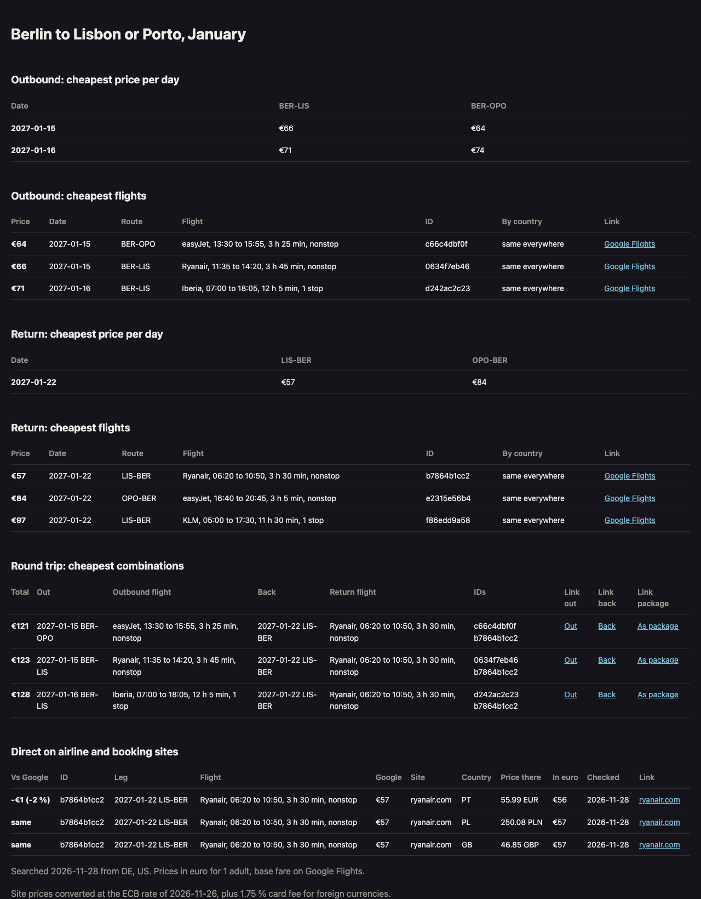

# flight-search

An agent asks where you want to fly, when, with what baggage, how you pay and where you want to buy. It searches Google Flights for every day and airport, repeats the search over VPN from other countries, checks the best flights directly on airline and booking sites abroad, and shows the cheapest options as tables with links.



## Setup

Once, about 5 minutes.

1. **uv** runs the script with its dependencies:
   macOS and Linux `curl -LsSf https://astral.sh/uv/install.sh | sh`,
   Windows `powershell -c "irm https://astral.sh/uv/install.ps1 | iex"`.
2. **Claude Code**: https://claude.com/claude-code. Other agents work too, they read `AGENTS.md`.
3. **Get the repo:**
   ```
   git clone https://github.com/sami-mag07/flight-search
   cd flight-search
   ```
4. **Searchify**, web search for the agent, free and without an API key: https://github.com/sami-mag07/searchify
   ```
   claude mcp add searchify -- uvx --from "searchify[mcp,rerank]" searchify-mcp
   ```
5. **Browser** for airline and booking sites (needs Node.js):
   ```
   claude mcp add playwright -- npx @playwright/mcp@latest
   ```
6. **Test:**
   ```
   $ uv run flight.py country
   DE
   ```

A VPN is optional, see below.

## Use

Start `claude` in the folder and say what you want:

> Find me flights from Berlin to Lisbon, out 15 or 16 January, back 22 January, one checked bag.

What happens, with a short example of each step:

1. **Interview.** The agent asks only what is missing: from, to, dates, flexibility, adults, baggage if you did not say, how you pay and which countries to buy in.
   ```
   How do you pay, and is a foreign currency fine?   Credit card, 1.75 % fee abroad
   Where should I compare?                           US, GB, PL, TR, BR
   ```
2. **Plan.** Airports, days, countries, sites and how long it takes.
   ```
   Airports  BER to LIS, OPO
   Days      out 15 to 16 Jan, back 22 Jan (6 queries)
   Countries DE, US, GB, PL, TR, BR
   Sites     airline, Kayak, Skyscanner, one local portal for the 2 best combinations
   Time      about 2 min Google, about 30 min sites
   ```
3. **Google Flights** for every day and airport, once per country.
   ```
   DE BER-LIS 2027-01-15: 129 flights
   DE BER-OPO 2027-01-15: 47 flights
   608 flights from 6 queries in results/lisbon.jsonl
   ```
4. **Airline and booking sites abroad.** For the best flights the agent opens the airline site, Kayak, Skyscanner and a local portal in each country and records the price it sees.
   ```
   b7864b1cc2 ryanair.com GB: 46.85 GBP = €55.94
   b7864b1cc2 ryanair.com PL: 250.08 PLN = €55.77
   ```
5. **Baggage.** The agent looks up whether a bag is included and what it costs, and adds it to the price (example values):
   ```
   | With bag    | Ticket | Bag   | Flight                        |
   | €111        | €66    | +€45  | Ryanair, 11:35 to 14:20       |
   | €97 + bag ? | €97    | ?     | KLM, 05:00 to 17:30, 1 stop   |
   ```
6. **Result** in the chat and as `results/board.html` (screenshot above):
   ```
   | Total | Out                | Outbound flight                       | Back               | Return flight                         |
   |-------|--------------------|---------------------------------------|--------------------|---------------------------------------|
   | €121  | 2027-01-15 BER-OPO | easyJet, 13:30 to 15:55, 3 h 25 min   | 2027-01-22 LIS-BER | Ryanair, 06:20 to 10:50, 3 h 30 min   |
   ```

## VPN and countries

| Way | Cost | How |
|---|---|---|
| Mullvad | €5 a month | The agent switches countries itself through `mullvad`. Install the Mullvad app and log in. |
| Any other VPN app | depends | The agent names the country, you switch it in the app and reply "go on". |
| Your own server | free if you have one | `ssh -f -N -D 1080 user@server`, then `FLIGHT_PROXY` in `.env` (template `.env.example`) and `uv run --env-file .env flight.py ...`. |
| Tor | free | `brew install tor` or `apt install tor`. Google often shows Tor a captcha. |

Before every round the script checks which country the IP really comes from and stops if the VPN is not up.

## What to expect

Measured, not guessed:

- **Google Flights**, test on 25 Nov 2026 with 2 IP countries, 8 market countries, several currencies and phone profiles: the same price everywhere.
- **ryanair.com**, same flight LIS-BER on 22 Jan 2027, checked on 28 Nov 2026: PT €55.99, GB £46.85 (€55.94), PL 250.08 zł (€55.77). Differences come from the exchange rate, less than 1 %.

So the country check is a safety net, not a money machine. If something is cheaper, it is most likely on a booking portal with its own discount or on a long haul airline with country specific fares. A price only counts if the agent saw it on the page.

## Without the agent

```
uv run flight.py search --from BER --to LIS,OPO --depart 2027-01-15..2027-01-16 --return 2027-01-22 --out results/lisbon.jsonl
uv run flight.py search --from BER --to LIS,OPO --depart 2027-01-15..2027-01-16 --return 2027-01-22 --country GB --out results/lisbon.jsonl
uv run flight.py links results/lisbon.jsonl --countries GB,TR,BR --top 2
uv run flight.py record --file results/lisbon.jsonl --id b7864b1cc2 --site ryanair.com --country GB --price 46.85 --currency GBP --per-person --url "<page url>"
uv run flight.py table results/lisbon.jsonl --baggage results/baggage.json --fx-fee 1.75
```

| Command and option | Meaning |
|---|---|
| `search --from`, `--to` | IATA codes, several with commas |
| `search --depart`, `--return` | dates with commas or as a range `2027-01-15..2027-01-18` |
| `search --adults` | adults, prices are then for all of them together |
| `search --stops 0` | nonstop only |
| `search --country`, `--proxy` | country round, see above |
| `search --out`, `--force` | result file (default `results/search.jsonl`), run even if the IP country does not match |
| `links --countries`, `--top` | Kayak and Skyscanner links per country for the best combinations |
| `record` | a price seen on a site, converted to euro at the ECB rate, saved in `results/sites.jsonl` |
| `record --per-person` | the site showed a price per person, multiply by the adults of the search |
| `table --baggage` | bag fees per airline, format in `CLAUDE.md` |
| `table --fx-fee` | card fee in percent for foreign currencies |
| `table --top`, `--max-hours`, `--max-stops` | shorten or filter the tables |
| `table --sites`, `--board` | site prices to show (default `results/sites.jsonl`), where the page goes (default `results/board.html`) |
| `country` | the country of your current IP |

## What the numbers mean

- Google prices are the economy base fare for all adults together, without checked bags. With `--baggage` the bag is added; where it is unknown the table says "+ bag ?".
- Out and back are two single flights added up. Google no longer returns round trips without a browser. The "As package" link opens the real round trip, which can be cheaper.
- A Google link opens the route on that day. Pick the flight there by airline and time from the table.
- Too many queries in a row get a captcha from Google, so the script waits 2 seconds between them.
- Nothing gets booked.
